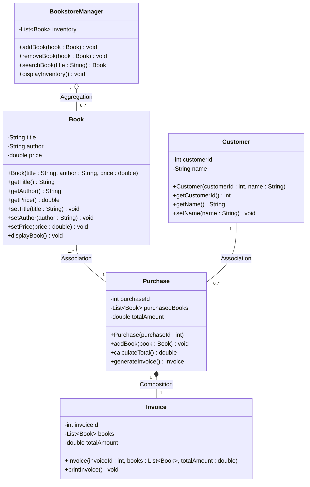

## 🏗️ Software Architecture Series
[Part 1: Procedural Baseline](https://github.com/Sharaf-Ahmed-Dev/arch-1-procedural) | **Part 2: OOP Migration (Current Repo)** | [Part 3: SOLID Principles](https://github.com/Sharaf-Ahmed-Dev/arch-3-solid) | [Part 4: Design Patterns](https://github.com/Sharaf-Ahmed-Dev/arch-4-patterns)

---

### Software Architecture Series - Part 2: Object-Oriented Refactoring

## 📌 Overview
This repository contains **Part 2 of a 4-part software architecture series**. In this phase, the monolithic procedural implementation from Part 1 is refactored into a clean, **Object-Oriented Architecture**. 

By replacing loose parallel arrays and global static states with encapsulated domain models (`Book`, `Customer`, `Purchase`, `Invoice`, `BookstoreManager`), the application achieves object-level encapsulation, data integrity guarantees, and dynamic memory isolation across customer sessions.

> [!NOTE]
> **Educational Intent:** This milestone demonstrates how encapsulating data and state logic within object instances eliminates array desynchronization risks and thread-safety hazards present in procedural baselines.

---

## 📐 UML Class Diagram

The system architecture models standard Object-Oriented relationships (**Aggregation**, **Association**, and **Composition**) between core entities:



---

## 🛠️ Code Structure & Domain Responsibilities

```text
arch-2-oop/
├── src/
│   ├── Book.java              # Entity: Encapsulates title, author, and price validation logic
│   ├── Customer.java          # Entity: Represents user profile & identity state
│   ├── Purchase.java          # Aggregator: Manages dynamic shopping cart & total calculation
│   ├── Invoice.java           # Presenter: Immutable transaction snapshot & receipt renderer
│   ├── BookstoreManager.java  # Service: Manages catalog state & collection query methods
│   └── Main.java              # Application Driver: Controls execution loop & CLI interaction
└── README.md

```

### Key Object Improvements

* **Encapsulation & Validation:** The `Book` entity guarantees invariants by throwing an `IllegalArgumentException` if a negative price is set.
* **Collection Aggregation:** `BookstoreManager` wraps a `List<Book>`, replacing procedural parallel arrays (`inventoryTitles`, `inventoryPrices`) with a unified collection.
* **Domain Separation:** Cart processing (`Purchase`) is separated from inventory management (`BookstoreManager`) and receipt formatting (`Invoice`).

---

## ⚖️ Architectural Trade-off Analysis

| Metric / Dimension | Part 1: Procedural | Part 2: OOP Migration | Target State (Part 4: Patterns) |
| --- | --- | --- | --- |
| **Data Integrity** | ❌ High risk (Parallel arrays easily desynchronize) | ✅ High (Encapsulated entity attributes) | ✅ High (Immutable value objects) |
| **State Management** | ❌ Global static variables (Thread unsafe) | ✅ Instance-based session memory | ✅ Contextual / Injected session state |
| **Coupling & I/O** | ❌ Tightly coupled in main loop | ⚠️ Moderate (`Invoice` handles printing logic) | ✅ Decoupled service layer & UI interfaces |
| **Extensibility** | ❌ O(N) invasive changes | 🟡 Improved (Modular classes, but lacks interfaces) | ✅ O(1) Open-Closed Principle adherence |

---

## ⚠️ Remaining Architectural Limitations (Target for Part 3)

> [!WARNING]
> **Single Responsibility & Dependency Coupling:** While OOP encapsulation is achieved, high-level components (`Main`, `Purchase`) still directly instantiate dependencies using concrete constructors (`new`), violating SOLID principles.

1. **Direct System I/O Dependency:** `Invoice` and `BookstoreManager` contain `System.out.printf` formatting methods, coupling domain data directly to terminal printing.
2. **Concrete Instantiations:** Controllers create concrete objects directly, preventing mock-based automated unit testing.

---

## 💻 Execution & Sample Output

### Prerequisites

* Java Development Kit (JDK 8 or higher)

### Build & Run Commands

```bash
# Navigate to source directory
cd src

# Compile all classes
javac Main.java

# Run application driver
java Main

```

### Console Session Log

```text
======================================================================
       WELCOME TO THE BOOKSTORE MANAGEMENT SYSTEM     
======================================================================

Please enter the customer's name: Javi

----------------------------------------------------------------------
                        AVAILABLE BOOK COLLECTION                     
----------------------------------------------------------------------
ID    | Book Title                        | Author               | Price ($)
----------------------------------------------------------------------
1     | To Kill a Mockingbird            | Harper Lee           | $18.99  
2     | 1984                             | George Orwell        | $15.50  
3     | The Great Gatsby                 | F. Scott Fitzgerald  | $12.75  
...
12    | Shoe Dog                         | Phil Knight          | $21.40  
13    | Clean Code                       | Robert C. Martin     | $45.99  
14    | Design Patterns                  | Erich Gamma          | $54.50  
15    | Head First Java                  | Kathy Sierra         | $42.80  
----------------------------------------------------------------------

Enter the Book ID you wish to purchase (1 - 15) or enter '0' when your book selection is complete: 1
--> SUCCESS: Added "To Kill a Mockingbird" ($18.99) to cart.

Enter the Book ID you wish to purchase (1 - 15) or enter '0' when your book selection is complete: 2
--> SUCCESS: Added "1984" ($15.50) to cart.

Enter the Book ID you wish to purchase (1 - 15) or enter '0' when your book selection is complete: 22
[ERROR] Invalid selection! Please enter a number between 1 and 15.

Enter the Book ID you wish to purchase (1 - 15) or enter '0' when your book selection is complete: 12
--> SUCCESS: Added "Shoe Dog" ($21.40) to cart.

Enter the Book ID you wish to purchase (1 - 15) or enter '0' when your book selection is complete: 0

======================================================================
                         BOOKSTORE TRANSACTION INVOICE                    
======================================================================
 Customer Name : Javi (ID: 101)
 Transaction ID: BK-TXN-6384
----------------------------------------------------------------------
 PURCHASED ITEMS:
 #     | Book Title                                    | Price ($)
----------------------------------------------------------------------
 1     | To Kill a Mockingbird                         | $18.99  
 2     | 1984                                          | $15.50  
 3     | Shoe Dog                                      | $21.40  
----------------------------------------------------------------------
 TOTAL PURCHASE AMOUNT:                                    $55.89
======================================================================

======================================================================
Thank you for visiting our bookstore. We wish you a great reading journey. Goodbye!
======================================================================

```

---

## 🔄 Next Phase

To eliminate direct concrete instantiation, decouple system console I/O, and adhere to strict enterprise principles, **[Part 3: SOLID Principles](https://github.com/Sharaf-Ahmed-Dev/arch-3-solid)** introduces interface abstractions, repository patterns, and dependency inversion.

```

```
